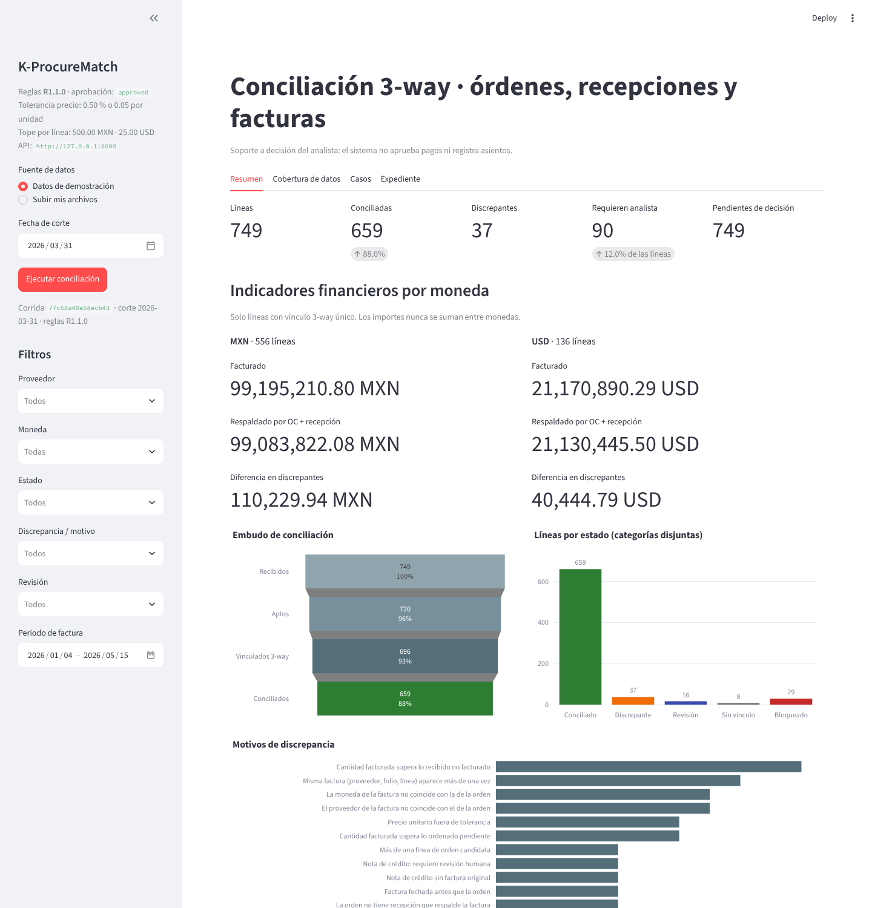
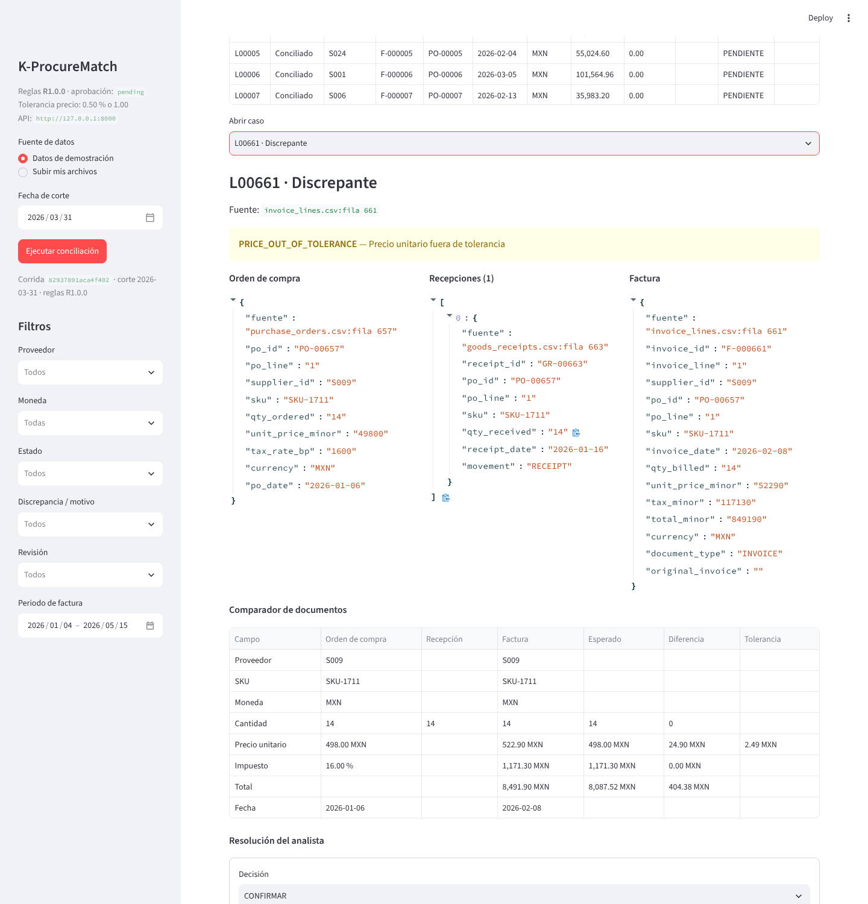

# K-ProcureMatch · Conciliación 3-way de compras

**Encuentra las discrepancias entre órdenes de compra, recepciones y facturas antes de que lleguen a pago: con reglas auditables, tolerancias versionadas y un expediente que respalda cada decisión.**



## El problema
En cuentas por pagar, una factura solo debería avanzar si coincide con lo que se ordenó y con lo que realmente se recibió. Cuando el cotejo es manual, se escapan sobreprecios, cantidades no recibidas, facturas duplicadas e impuestos mal calculados, y queda poca evidencia de por qué se aceptó cada diferencia.

## Qué hace
1. **Importa** las tres fuentes (o usa el conjunto de demostración) y muestra su cobertura, sus periodos y los registros inválidos.
2. **Valida** identificadores, tipos, monedas, fechas y duplicados. Las filas inválidas se señalan por archivo y fila, nunca se borran en silencio.
3. **Concilia** con reglas deterministas versionadas y tolerancias configurables. Contempla recepciones parciales, devoluciones, facturación parcial y varias monedas.
4. **Clasifica** cada línea en un embudo de categorías disjuntas: recibidos → aptos → vinculados → conciliados, con discrepantes, en revisión, sin vínculo y bloqueados aparte.
5. **Explica** cada caso: los tres documentos vinculados lado a lado, las diferencias de cantidad, precio, impuesto y total, el motivo de la clasificación y la fila exacta de cada fuente.
6. **Registra** la decisión del analista y **exporta** el expediente (CSV, JSON y HTML imprimible) con el hash de cada archivo de entrada y la versión de reglas.



> **Frontera:** es soporte a la decisión del analista. No aprueba pagos, no registra asientos y no crea órdenes en ningún ERP.

## Resultados verificados
Medidos sobre el conjunto sintético de demostración (749 líneas, MXN y USD, 27 escenarios etiquetados) con `python run.py evaluate`. CI vuelve a calcularlos en cada cambio.

| Indicador | K-ProcureMatch (reglas R1.0.0) | Motor de reglas anterior (v0) | Cotejo manual |
|---|---|---|---|
| Falsas coincidencias (factura aprobada que no debía) | **0** | 4 | — |
| Exactitud de clasificación (5 estados) | **100 %** | 81.8 % (solo MATCH / no MATCH) | — |
| Coincidencias correctas enviadas a revisión innecesaria | **0** | 132 | — |
| Esfuerzo de revisión (líneas que exigen analista) | **11.9 %** | 29.0 % | 100 % |
| Diferencias monetarias inyectadas detectadas al centavo | **24 / 24** (MXN y USD por separado) | — | — |

El motor v0 aprobaba facturas con fecha futura o ligadas a órdenes inválidas, y enviaba a revisión todas las líneas en USD, las diferencias dentro de tolerancia y la facturación parcial. **Estos resultados son de datos sintéticos** y no constituyen un ahorro medido en una operación real.

**¿Por qué sin Machine Learning?** Las reglas deterministas ya logran cero falsas coincidencias en este conjunto y cada decisión es explicable. Un modelo solo se consideraría con datos reales y si redujera el esfuerzo de revisión sin aumentar las falsas coincidencias.

## Pruébalo
```bash
python -m venv .venv
source .venv/bin/activate          # Windows: .venv\Scripts\Activate.ps1
python -m pip install -r requirements.txt
python run.py dashboard            # interfaz del analista → http://localhost:8501
python run.py demo                 # conciliación sin interfaz → demo_output/ (expediente completo)
python run.py api                  # API REST → http://127.0.0.1:8000/docs
python run.py test                 # pruebas automatizadas
python run.py evaluate             # indicadores → reports/metrics.json
```
Con Docker: `docker compose up` levanta la API (puerto 8000) y el dashboard (puerto 8501).

## Criterios de aceptación y su prueba
| Criterio | Qué garantiza | Pruebas |
|---|---|---|
| AC-I19-01 | Una entrada sin clave esencial, con moneda incompatible o con formato inválido se identifica por archivo y fila, y no genera una conciliación falsa | `T_I19_04_*` |
| AC-I19-02 | Un caso exacto se clasifica `MATCH`; una diferencia fuera de tolerancia, `EXCEPTION`, con importes y regla auditables | `T_I19_01_*`, `T_I19_02_*` |
| AC-I19-03 | Candidatos ambiguos y facturas duplicadas no se vinculan automáticamente: van a revisión | `T_I19_03_*` |
| AC-I19-04 | Los filtros y conteos de la interfaz reproducen los del motor, sin diferencias de totales (verificado contra SQL independiente y contra el dashboard renderizado) | `T_I19_05_funnel…`, `T_I19_05_ui_filters…`, `T_I19_05_dashboard…` |
| AC-I19-05 | La exportación incluye decisión humana, motivos, versión de reglas, referencias y hashes; no contiene operaciones de pago ni de ERP | `T_I19_05_export…`, `test_api_rejects…` |

Las pruebas están en `tests/test_acceptance.py` y corren en Linux y Windows en cada cambio.

## Cómo funciona
| Capa | Tecnología | Por qué |
|---|---|---|
| Contratos de datos | Pydantic | Valida cada fila y produce errores con código, campo y fila |
| Ingesta y cobertura | DuckDB (SQL) | Lee los CSV como texto sin perder filas; persiste corridas y decisiones |
| Motor | Python + pandas | Reglas deterministas; importes en enteros (centavos), sin flotantes |
| Interfaz | Streamlit + Plotly | Filtros por proveedor, periodo, moneda, discrepancia y estado de revisión; embudo; comparador de documentos |
| API | FastAPI | Consumo programático; CI la arranca en un contenedor y consume sus endpoints |
| Entrega | Docker, GitHub Actions | Pruebas en Ubuntu y Windows; build de la imagen y arranque real de la API y del dashboard |

- Reglas y tolerancias: [`rules/rules_v1.yaml`](rules/rules_v1.yaml) · catálogo de motivos: [`docs/reglas.md`](docs/reglas.md)
- Formato de entrada: [`docs/contrato_datos.md`](docs/contrato_datos.md)
- El motor v0 original se conserva en `src/i19/` como línea base de comparación.

## Estado y siguiente paso
Sistema funcional y verificado con datos sintéticos. Las tolerancias de `rules_v1.yaml` son una **propuesta pendiente de aprobación** por el responsable de cuentas por pagar. El expediente se exporta en CSV, JSON y HTML imprimible; el PDF nativo se incorporaría si se contrata ese formato.

El siguiente paso es un **piloto con datos reales** de su área de compras, bajo acuerdo de uso y confidencialidad, para medir las falsas coincidencias y el esfuerzo de revisión frente a su proceso actual.

**¿Le interesa un piloto?** Contacte a **Kriter Systems**.

---
I19 · Kriter Systems · Los datos incluidos son sintéticos y no representan a personas ni empresas reales.
